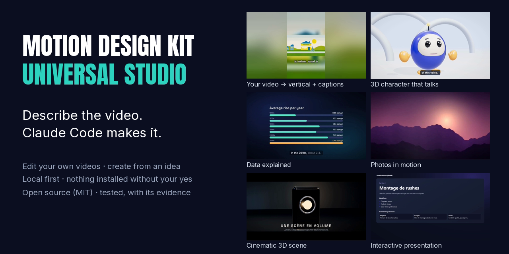

<p align="center">
  
</p>

# Motion Design Kit · Universal Studio

**Describe the video. Claude Code makes it on your computer, then checks the result.**

[Guide en français](LISEZ-MOI.md) · [Guía en español](LEEME.md) · [Starter message](PROMPT-INSTALACION.txt) · [Test report](docs/TEST-REPORT.md) · [Security](SECURITY.md) · MIT licence · v3.1.0

A video studio for [Claude Code](https://claude.com/download). You say what you need in plain words and hand over your files if you have any. Claude picks the tools, makes the video and checks it. Nobody types a command.

It works on videos you already have and creates new ones from an idea, for YouTube, TikTok, Instagram, Shorts and LinkedIn, long or short.

## What it does

**A video you already have**

| You say | You get |
|---|---|
| "Remove the silences" | The same video without dead air, each cut keeping a breath |
| "Add subtitles" | Burned-in captions, after Claude has read and corrected the transcript |
| "Subtitle it in English and Spanish" | One video per language |
| "Make it vertical for TikTok" | A 9:16 frame that follows the face, or the whole picture over a blurred background |
| "Cut three short clips for Instagram" | One file per clip, cut on word boundaries |
| "Write the YouTube chapters" | The chapter list, ready to paste |
| "Edit these clips with my logo and my music" | A montage at a broadcast loudness |

Your video is kept whole and in its own shape unless you ask otherwise. Transcription runs offline.

**An idea**

Promo or ad · kinetic text · animated logo · photos in motion · data explainer built from sourced data · 3D character that talks · cinematic 3D scene · 66 film styles written in code (watercolour, risograph, woodblock print…) · interactive HTML presentation with real buttons.

Formats 16:9, 9:16, 1:1 and 4:5. Every render starts as a draft, then goes to review, final or 4K.

## How it works

```
first message ─► start            already installed: ready in half a second; otherwise the setup assistant
words + files ─► inventory        reads the real files (ffprobe, GLB headers, CSV) and changes nothing
              ─► router           intent, style, format and engine, and it says when it is only guessing
              ─► project.json     a validated contract
              ─► engine           FFmpeg · Remotion · HTML · film styles · effects · Blender
              ─► quality check    loudness, black frames, freezes, duration, safe areas, contact sheet
```

Claude understands the request. Deterministic Python tools do the heavy lifting and report what they measured. A request that was not understood is not executed, so nothing is delivered on a guess.

## Quick start

1. Install the Claude desktop app and open the **Code** tab.
2. Download this repository (**Code → Download ZIP**) and unzip it in a local folder, not a cloud-synced one.
3. Open the folder in Claude Code and paste the starter message from [PROMPT-INSTALACION.txt](PROMPT-INSTALACION.txt), available in English, French and Spanish.

The setup assistant first looks at your machine without changing anything. It then shows a table of what is already there and what is missing, and **asks before installing each element**. It installs only what you accept, runs every engine and makes two test videos. Each part ends up as READY, WARNING, FAILED or OPTIONAL. Tools that already work are recognised and left alone.

No Claude Code at hand? Double-click `INSTALAR.bat` on Windows, or run `./instalar.sh` on macOS and Linux: the same assistant asks the same questions in a terminal window.

| Element | Level | Where | Size |
|---|---|---|---|
| Python 3.10+, FFmpeg 6+, Node.js 22+ | Required | Computer | about 320 MB |
| Creation engine (Remotion) | Required | Kit folder | 1.2 GB |
| Automatic captions (faster-whisper) | Recommended | Kit folder | 345 MB |
| Free voice-over (Kokoro), effects around a person, film styles, animated interfaces, HyperFrames, design check | Optional | Kit folder | 20 to 550 MB each |
| Blender, Git, uv | Optional | Computer | |
| ElevenLabs | Optional, paid | Your account | |

Only want to work on videos you already have? Decline the creation engine. Everything else keeps working, and the report records it as your choice, not as a failure.

## Security by design

- **Nothing is installed without a yes for that element.** The assistant names every tool, its size and where it goes. When it installs through winget or Homebrew, the question mentions the licence that the installation accepts. On Linux, anything that needs `sudo` is handed to you to type.
- **What works is left alone.** An element that is present and usable is reported, never reinstalled.
- **Exact versions.** npm installs from lockfiles. Python packages arrive as prebuilt wheels checked with `--require-hashes`, so no install script runs. The voice model and the sample packs are verified by SHA-256, the transcription model is fetched at a fixed revision, and the design checker binary is verified before every run.
- **Keys stay secret.** API keys are never read, printed or logged: only their presence is checked. The ElevenLabs key is typed into a masked prompt, never into the chat.
- **Clean logs.** Keys, tokens, user name, machine name and home folder are removed before anything is written.
- **Nothing personal ships.** Your profile, videos, settings, install state and logs are ignored by Git. The packaging script refuses to build if it finds a key, a personal folder or a path of your machine.
- **Contained uninstall.** Only folders the kit generated inside itself can be removed, and only the ones you name. Your profile, your videos and your settings are never deleted by the kit.
- **Nothing updates itself.** The update check compares versions and changes nothing. HyperFrames' telemetry and update checks are switched off, and transcription runs in offline mode.
- **People and money.** Using a real voice or face, any paid call and any publication always need your approval.

Guarantees, where each one is enforced, and the known risks: [SECURITY.md](SECURITY.md).

## Token and cost economy

The kit is built so that Claude reads little and decides well. Measured on v3.1.0 ([method and details](docs/TOKEN-ECONOMY.md)):

| What Claude reads | Size | ≈ tokens |
|---|---|---|
| Always in context: `CLAUDE.md` and the 21 skill descriptions | 12.4k characters | 3,500 |
| Start of a conversation once installed | one short status, no setup skill loaded | 400 |
| The routing card, instead of the full manifest | 259 instead of 3,225 characters | 70 instead of 900 |
| One contact sheet, instead of ten separate frames | one 1600×360 image | 770 instead of 12,300 |
| The readable transcript, instead of word timings | 5.4 times smaller | |

Everything runs locally by default, so a video costs no API fee. Paid calls (ElevenLabs) need a yes for each call, stay under a cost ceiling and are cached, so the same line is never paid for twice. Renders start as drafts.

## What was tested, and what was not

Tested on Windows 11 (Intel i5-1240P, Intel Iris Xe and NVIDIA T550):

- 195 unit tests, also run under Linux in WSL (without FFmpeg, 28 skipped), and in a raw download with no engine installed (3 skipped).
- 13 engine regression checks and 12 real cases on a provided video, including a 20-minute video with 343 cuts.
- The setup assistant end to end, and the kit unzipped into an empty folder: first launch, refusal to install without approval, approved installation, two test videos, ready. 26 checks.

Not tested yet:
- following a real person's face, which needs a consenting volunteer;
- installing a missing system tool through winget or Homebrew, since everything was already installed;
- macOS, and rendering on Linux;
- videos longer than 20 minutes;
- how Claude behaves in a brand-new conversation: the instructions are written, but the behaviour has not been measured.

Every claim is backed by a file in [docs/preuves](docs/preuves) and summarised in [docs/TEST-REPORT.md](docs/TEST-REPORT.md).

## Configuration

`kit.config.json` holds every setting with its default. To change a value for yourself only, write the same key in `kit.config.local.json`, which never leaves your computer. Highlights:

- `consent.free_modules`: `ask` by default; `auto` lets free kit options install without asking.
- The loudness target, −14 LUFS by default.
- The hardware encoder policy.
- The silence, caption and reframing settings.
- How long logs are kept.

## Project layout

| Path | Role |
|---|---|
| `universal/` | The kit itself: routing, inventory, treatments, montage, voice, quality check, setup assistant. Python standard library only |
| `universal/workflows/` | Treatments of a provided video, one file each |
| `template/`, `prompt-motion/`, `hyperframes-starter/` | Creation engines |
| `modules/` | Optional modules, pinned and installed inside the kit |
| `.claude/skills/` | The kit's 21 skills, loaded when the folder is opened in Claude Code |
| `docs/`, `tests/` | Documentation, tests and their evidence |

The kit's messages are written in French and its skills in Spanish; Claude answers you in your language (French, Spanish or English).

## Licences and credits

- The kit's own code is released under the [MIT licence](LICENSE), © 2026 Geniiius.
- Bundled third-party code keeps its licence:
  - Opuscar film styles: MIT, LemoLab.
  - Video effects: MIT, Vibha Ramprakash.
  - YuNet model: MIT. MediaPipe model: Apache-2.0.
  - Fonts: OFL and Apache-2.0.
  - RobotExpressive model: CC0.
  - NOAA data, with the citation it requests.
  - Full list: [docs/THIRD-PARTY.md](docs/THIRD-PARTY.md).
- **Remotion is not open source.** It is free for individuals and for companies of up to three people; larger companies need a Remotion company licence. Check before any commercial use.
- GSAP is free under GreenSock's no-charge licence.
- Claude is a trademark of Anthropic. YouTube, TikTok, Instagram, iMessage, iPhone and LinkedIn belong to their owners. The "Prompt Motion" engine is a style inspired by prompt-motion.com. This project is independent, and it is not affiliated with or endorsed by any of them.

## Contributing

Issues and pull requests are welcome. Ground rules, conventions and how to run the tests are in [CONTRIBUTING.md](CONTRIBUTING.md). For a security problem, please report it privately as described in [SECURITY.md](SECURITY.md).
